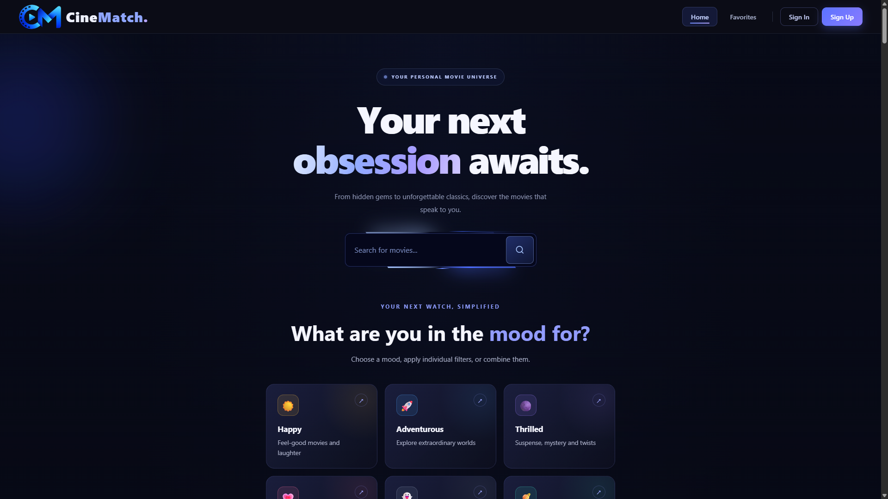
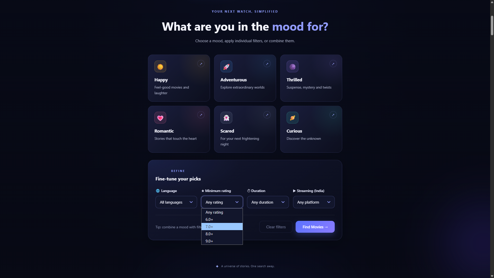
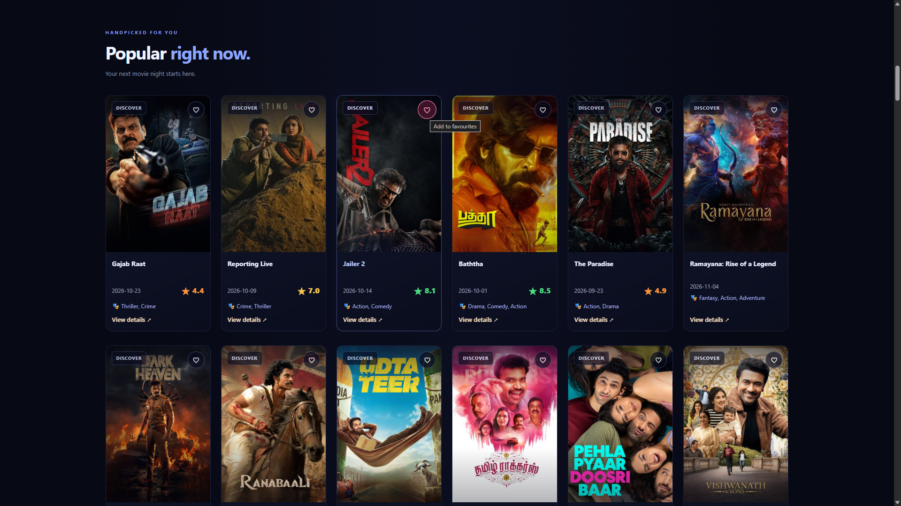
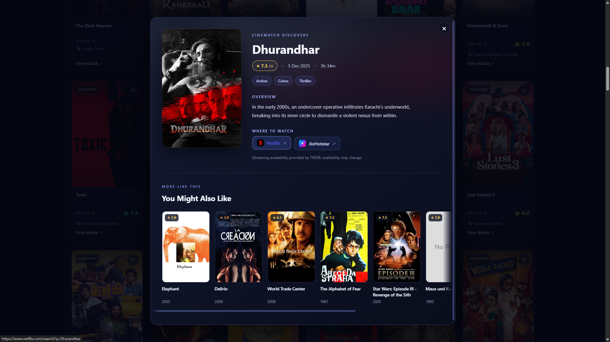
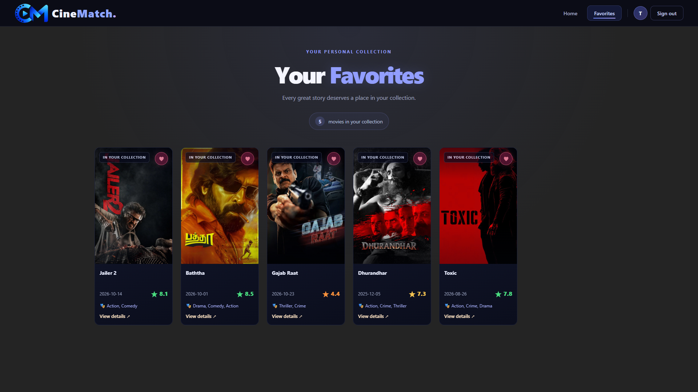
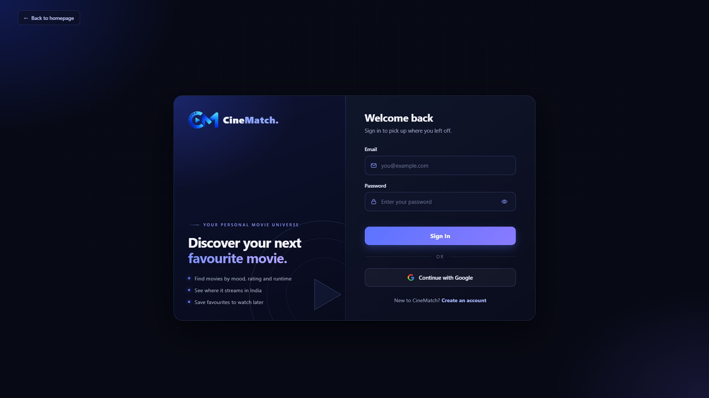

# CineMatch 🎬

<p align="center">
  
</p>

<h3 align="center">Your Personal Movie Universe</h3>

<p align="center">
  Discover movies by mood, explore hidden gems, refine your search, and find your next favourite film.
</p>

<p align="center">
  <strong>React · Vite · Express.js · TMDB API · Supabase</strong>
</p>

---

## Table of Contents

- [Overview](#overview)
- [Live Demo](#live-demo)
- [Screenshots](#screenshots)
- [Features](#features)
- [System Architecture](#system-architecture)
- [Solving the TMDB DNS Problem](#solving-the-tmdb-dns-problem)
- [Technology Stack](#technology-stack)
- [Repository Structure](#repository-structure)
- [Getting Started](#getting-started)
- [Environment Variables](#environment-variables)
- [Backend API Reference](#backend-api-reference)
- [Supabase Configuration](#supabase-configuration)
- [Security Considerations](#security-considerations)
- [Troubleshooting](#troubleshooting)
- [Credits and Attribution](#credits-and-attribution)
- [Future Enhancements](#future-enhancements)
- [Author](#author)

---

## Overview

**CineMatch** is a full-stack movie discovery application designed to make finding your next movie an engaging and personalised experience.

Instead of relying on a simple title search, users can explore popular movies, search for specific films, discover movies based on their mood, and refine results using practical filters. The application also provides movie details, similar-title recommendations, regional streaming-provider information, and a personal favourites collection.

The project consists of two independently maintained repositories:

- **Frontend:** A React single-page application built with Vite.
- **Backend:** An Express.js proxy server that forwards TMDB API requests and keeps the TMDB API key on the server.

Supabase handles user authentication and persistent favourites, allowing signed-in users to maintain their own movie collections.

A key engineering decision was introducing a backend proxy after encountering a DNS/network-resolution problem when accessing TMDB directly from the frontend environment. This separates external movie-data requests from the browser and provides a dedicated server-side integration layer.

### Project Goals

- Build a practical, full-stack application with a polished user experience.
- Make movie discovery more intuitive through mood-based recommendations and combined filters.
- Integrate third-party movie data through a dedicated backend.
- Keep the TMDB API key out of frontend code.
- Implement authentication and user-specific persistent data.
- Deploy the frontend and backend as separate services.

## Live Demo

- **Application:** https://cinematchbytc.vercel.app/
- **Backend health check:** https://cinematch-backend-ozzq.onrender.com/health

## Screenshots

The following section is reserved for screenshots of the application. Add images as the project evolves and replace the example paths with the actual filenames you upload.

### 1. Home Page and Movie Discovery



### 2. Mood-Based Discovery and Filter



### 3. Movie Details and Similar Movies



### 4. Streaming Availability



### 5. Favourites Collection



### 6. Authentication



---

## Features

### 🎬 Movie Discovery

- Browse popular movies.
- Prioritise Indian titles in selected discovery results.
- Search for movies by title.
- Explore movie posters, ratings, release information, and descriptions.
- Open a detailed movie view for additional information.
- Discover similar movies from a selected title.
- Automatically scroll to the results section after a search or recommendation.

### 🎭 Mood-Based Recommendations

Choose a mood to begin exploring movies that fit the experience you're looking for.

| Mood | Genre | Discovery Focus |
|---|---|---|
| Happy | Comedy | Feel-good movies and laughter |
| Adventurous | Adventure | Extraordinary worlds and exploration |
| Thrilled | Thriller | Suspense, mystery, and twists |
| Romantic | Romance | Emotional and heartwarming stories |
| Scared | Horror | Horror and frightening experiences |
| Curious | Science Fiction | Futuristic concepts and the unknown |

Mood selections are translated into genre-based discovery requests through TMDB.

### 🎛️ Advanced Movie Filters

Refine movie discovery by combining several criteria:

- **Minimum rating:** Filter movies by their minimum TMDB rating.
- **Runtime:** Explore movies based on duration.
- **Language:** Filter by original language.
- **Streaming platform:** Find titles associated with selected platforms in India.
- **Genre or mood:** Combine a genre selection with other filters.

Supported language filters include English, Hindi, Bengali, Tamil, Telugu, Malayalam, Kannada, Marathi, Punjabi, Japanese, Korean, Chinese, French, Spanish, and German.

Supported streaming-platform filters include Netflix, Amazon Prime Video, JioHotstar, ZEE5, Sony LIV, Apple TV+, and YouTube Movies, subject to the provider data returned by TMDB.

### 🔎 Movie Details

The movie details interface provides:

- Movie poster and title.
- Release date and rating.
- Runtime when available.
- Genre information.
- Movie overview.
- Streaming-provider information.
- Similar movie suggestions.

The details interface also supports closing the modal with the Escape key and navigating between similar movie selections.

### 📺 Where to Watch

CineMatch retrieves regional watch-provider information from TMDB for India.

Users can explore available provider names and logos and open supported streaming services' search pages for a selected movie.

Streaming information is provided for discovery purposes. Availability can vary by region, subscription, and date, so provider listings should not be treated as a guarantee that a title is currently included in a particular subscription.

### ❤️ Personal Favourites

CineMatch includes a personal movie collection for signed-in users.

- Create an account using email and password.
- Sign in and sign out.
- Use Google authentication when configured in Supabase.
- Save movies to favourites.
- Remove movies from the collection.
- Retrieve saved movies from Supabase.
- View the collection on a dedicated Favourites page.

### ⚡ User Experience and Performance

- Responsive, custom-styled interface.
- Reusable React components.
- Client-side routing.
- Loading, error, and empty-result states.
- Session-based caching of movie API responses.
- A 24-hour cache duration for cached TMDB responses.
- Concurrent detail requests for selected movie-filtering operations.

---

## System Architecture

CineMatch uses a separate frontend and backend, with Supabase providing authentication and persistent favourites.

```text
                     USER'S BROWSER
                            |
                            v
              +---------------------------+
              |       React + Vite        |
              |                           |
              |  Home and Search          |
              |  Mood-Based Discovery     |
              |  Filters and Movie Cards  |
              |  Movie Details            |
              |  Favourites and Login     |
              +-------------+-------------+
                            |
              +-------------+-------------+
              |                           |
              v                           v
   +----------------------+    +----------------------+
   | Express.js Backend    |   | Supabase             |
   |                       |   |                      |
   | /api/tmdb/*           |   | Authentication       |
   | TMDB API-key injection|   | Favourites storage   |
   | CORS configuration    |   | User-specific data   |
   +-----------+----------+    +----------------------+
               |
               v
   +----------------------+
   | The Movie Database   |
   |                      |
   | Search and Discovery |
   | Movie Details        |
   | Similar Movies       |
   | Watch Providers      |
   +----------------------+
```

### Request Flow

1. The user searches for a movie or applies discovery filters in the React application.
2. The frontend sends a request to the configured backend URL under `/api/tmdb`.
3. The Express backend maps the request to the corresponding TMDB API v3 endpoint.
4. The backend adds the TMDB API key from its server-side environment variables.
5. The backend sends the request to TMDB and returns the upstream response to the frontend.
6. The frontend processes the response, normalises the movie data, and renders the results.

Supabase is used separately for authentication and favourites. The browser communicates with Supabase through its client library using the project's URL and publishable key.

---

## Solving the TMDB DNS Problem

One of the important technical challenges during development was a DNS/network-resolution problem encountered when accessing the TMDB API directly from the frontend environment.

A browser-based application depends on the user's network and browser environment to resolve and reach external API hosts. When direct TMDB access failed in the affected environment, a backend proxy provided an alternative request path.

### The Solution: Express.js TMDB Proxy

Instead of making movie-data requests directly to TMDB from the frontend, CineMatch routes them through a dedicated Express.js service.

The backend performs the following operations:

1. Receives requests at `/api/tmdb/*`.
2. Extracts the TMDB endpoint path from the incoming request.
3. Constructs the corresponding TMDB API v3 URL.
4. Injects the private TMDB API key on the server.
5. Sends the upstream request to `https://api.themoviedb.org/3`.
6. Relays the upstream HTTP status, content type, and response body to the frontend.

For example, a frontend request such as:

```http
GET /api/tmdb/search/movie?query=Inception
```

is forwarded to the corresponding TMDB movie-search endpoint, with the API key added by the backend.

### Why This Helps

The browser no longer needs to make the TMDB API request directly. Instead, the request originates from the backend hosting environment.

When that environment can resolve and reach TMDB successfully, the proxy avoids relying on the affected frontend/client network path.

**Important:** The proxy does not repair DNS itself. It changes where the outbound request originates, providing an alternative route to the external service. If the backend environment also experiences DNS or connectivity problems, the request can still fail.

### Additional Backend Capabilities

The proxy also includes:

- A `/health` endpoint for checking service availability.
- Environment-based configuration.
- CORS restrictions using an explicit list of allowed origins.
- A clear configuration error when `TMDB_API_KEY` is missing.
- A `502 Bad Gateway` response when the upstream connection cannot be completed.
- Server-side logging for proxy connection errors.

This solution also keeps the TMDB API key out of the browser's network requests and frontend JavaScript bundle.

---

## Technology Stack

| Technology | Purpose |
|---|---|
| React 19 | Component-based frontend development |
| Vite | Development server and production build tooling |
| JavaScript and JSX | Application logic and UI components |
| React Router DOM | Client-side navigation |
| CSS | Custom interface styling |
| Node.js | Backend runtime |
| Express.js 4 | HTTP server and TMDB proxy |
| CORS | Browser-origin access configuration |
| dotenv | Local backend environment configuration |
| TMDB API v3 | Movie metadata, search, discovery, similar movies, and watch providers |
| Supabase | Authentication and persistent favourites |
| Git and GitHub | Version control and source-code hosting |

---

## Repository Structure

CineMatch is maintained across two repositories.

### Frontend Repository

**Repository:** [ami-chatterjee-bolchi/CineMatch](https://github.com/ami-chatterjee-bolchi/CineMatch)

```text
CineMatch/
├── public/
│   └── Static assets and branding
├── src/
│   ├── Services/
│   │   ├── movieApi.js
│   │   └── supabase.js
│   ├── assets/
│   ├── components/
│   │   ├── MovieCard.jsx
│   │   ├── MovieDetailsModal.jsx
│   │   ├── MovieFinder.jsx
│   │   └── NavBar.jsx
│   ├── context/
│   │   └── MovieContext.jsx
│   ├── css/
│   ├── pages/
│   │   ├── Home.jsx
│   │   ├── Favorites.jsx
│   │   └── Login.jsx
│   ├── App.jsx
│   └── main.jsx
├── .env.example
├── package.json
├── package-lock.json
└── vite.config.js
```

**Key files:**

- `src/Services/movieApi.js` — Handles TMDB proxy requests, response caching, movie-data normalisation, discovery filters, and similar-movie retrieval.
- `src/Services/supabase.js` — Initialises the Supabase client.
- `src/context/MovieContext.jsx` — Manages authentication state and favourites operations.
- `src/components/MovieFinder.jsx` — Implements mood-based discovery and filters.
- `src/components/MovieDetailsModal.jsx` — Displays movie details, streaming providers, and similar movies.
- `src/pages/Home.jsx` — Main discovery interface.
- `src/pages/Favorites.jsx` — Personal favourites collection.
- `src/pages/Login.jsx` — Authentication interface.

### Backend Repository

**Repository:** [ami-chatterjee-bolchi/Cinematch-backend](https://github.com/ami-chatterjee-bolchi/Cinematch-backend)

```text
Cinematch-backend/
├── server.js
├── package.json
└── package-lock.json
```

**Key files:**

- `server.js` — Configures Express, CORS, the health endpoint, and the TMDB proxy.
- `package.json` — Defines backend dependencies and start scripts.

---

## Getting Started

Follow these instructions to run the frontend and backend locally.

### Prerequisites

Install:

- [Node.js](https://nodejs.org/) — preferably a current LTS release.
- npm, which is included with Node.js.
- A [TMDB API key](https://developer.themoviedb.org/docs).
- A [Supabase project](https://supabase.com/) for authentication and favourites.

### 1. Clone and Configure the Backend

Clone the backend repository:

```bash
git clone https://github.com/ami-chatterjee-bolchi/Cinematch-backend.git
cd Cinematch-backend
```

Install the dependencies:

```bash
npm install
```

Create a `.env` file in the backend root:

```env
PORT=3000
TMDB_API_KEY=your_tmdb_api_key
ALLOWED_ORIGINS=http://localhost:5173
```

Replace `your_tmdb_api_key` with your actual TMDB API key.

Start the backend in development mode:

```bash
npm run dev
```

Alternatively, start it using:

```bash
npm start
```

The backend should now be available at:

```text
http://localhost:3000
```

Check the health endpoint:

```text
http://localhost:3000/health
```

A successful response looks like:

```json
{
  "ok": true,
  "service": "cinematch-tmdb-proxy"
}
```

### 2. Clone and Configure the Frontend

Open a second terminal and clone the frontend repository:

```bash
git clone https://github.com/ami-chatterjee-bolchi/CineMatch.git
cd CineMatch
```

Install the dependencies:

```bash
npm install
```

Create a `.env` file in the frontend root:

```env
VITE_API_BASE_URL=http://localhost:3000
VITE_SUPABASE_URL=https://your-project.supabase.co
VITE_SUPABASE_PUBLISHABLE_KEY=your_supabase_publishable_key
```

Replace the example Supabase values with your actual project URL and publishable key.

Start the frontend:

```bash
npm run dev
```

Open the local address printed by Vite, usually:

```text
http://localhost:5173
```

### 3. Verify the Integration

After both services are running:

1. Check that the backend `/health` endpoint responds successfully.
2. Confirm that `VITE_API_BASE_URL` points to the running backend.
3. Open the frontend and check that popular movies load.
4. Test movie search and the available discovery filters.
5. Open a movie's details and check similar movies and provider information.
6. Configure Supabase and test account creation, sign-in, and favourites.

---

## Environment Variables

### Frontend Configuration

| Variable | Required | Description |
|---|---|---|
| `VITE_API_BASE_URL` | Yes for a separately hosted backend | Base URL of the Express proxy, without a trailing slash |
| `VITE_SUPABASE_URL` | Yes | Supabase project URL |
| `VITE_SUPABASE_PUBLISHABLE_KEY` | Yes | Supabase publishable key used by the browser client |

For local development, `VITE_API_BASE_URL` should point to `http://localhost:3000`.

For production, set it to the deployed backend's base URL.

### Backend Configuration

| Variable | Required | Description |
|---|---|---|
| `TMDB_API_KEY` | Yes | TMDB API key used by the server |
| `PORT` | No | Port on which Express listens; defaults to `3000` |
| `ALLOWED_ORIGINS` | Recommended | Comma-separated list of permitted browser origins |

Example:

```env
PORT=3000
TMDB_API_KEY=your_tmdb_api_key
ALLOWED_ORIGINS=http://localhost:5173,https://your-frontend-domain.example
```

Replace the example frontend origin with your actual deployment origin.

When deploying to a hosting provider, configure these values in the provider's environment settings rather than committing secrets to the repository.

**Security note:** Vite exposes variables prefixed with `VITE_` to browser-side code. Never place the TMDB secret API key in a frontend environment variable.

---

## Backend API Reference

The backend exposes a health endpoint and a wildcard route for TMDB GET requests.

### Health Check

**Endpoint:**

```http
GET /health
```

**Example response:**

```json
{
  "ok": true,
  "service": "cinematch-tmdb-proxy"
}
```

This endpoint can be used to verify that the backend service is running.

### TMDB Proxy

**Endpoint:**

```http
GET /api/tmdb/*
```

The wildcard route forwards the requested path to the equivalent TMDB API v3 endpoint.

#### Example Requests

Search for a movie:

```http
GET /api/tmdb/search/movie?query=Inception
```

Retrieve movie details:

```http
GET /api/tmdb/movie/27205
```

Retrieve similar movies:

```http
GET /api/tmdb/movie/27205/similar?language=en-US&page=1
```

Retrieve watch providers:

```http
GET /api/tmdb/movie/27205/watch/providers
```

The backend injects the configured API key into the upstream request.

It relays the upstream HTTP status and response body to the frontend. If the server-side API key is missing, it returns a configuration error. If the upstream request cannot be completed, it returns a `502` response.

The current proxy is designed for the application's TMDB GET requests rather than functioning as a general-purpose proxy.

---

## Supabase Configuration

CineMatch uses Supabase for user authentication and persistent favourites.

### Authentication

The frontend supports:

- Email and password registration.
- Email and password sign-in.
- Sign-out.
- Google sign-in when the Google provider is configured.

To enable these features:

1. Create a Supabase project.
2. Add the project URL and publishable key to the frontend environment variables.
3. Enable the authentication methods you intend to use.
4. If using Google sign-in, configure the Google provider and the permitted redirect URLs in Supabase.

### Favourites Database

The frontend expects a table named `favourites` containing the following fields:

| Column | Purpose |
|---|---|
| `user_id` | ID of the signed-in user |
| `movie_id` | TMDB movie ID, stored as text by the current client logic |
| `movie_data` | Stored movie object, suitable for a JSON/JSONB column |

The client uses these fields to load, add, and remove favourites.

A unique constraint on `(user_id, movie_id)` is required for the current upsert operation.

**Important:** Configure Row Level Security (RLS) and appropriate policies so each authenticated user can access only their own favourites. The exact SQL schema and policies should match your Supabase project configuration.

---

## Security Considerations

Security is an important part of the application's architecture.

- **Keep the TMDB API key on the backend.** Store `TMDB_API_KEY` in the backend environment, not in frontend code.
- **Do not commit secrets.** Keep real `.env` files and private credentials out of Git.
- **Treat frontend environment variables as public.** Any `VITE_*` value may be included in the browser bundle.
- **Secure Supabase data.** Use RLS and appropriate policies to restrict favourites to their owners.
- **Configure CORS carefully.** Set `ALLOWED_ORIGINS` to the exact frontend origin or origins permitted to access the proxy from a browser.
- **Understand CORS limitations.** CORS is a browser access policy, not authentication or a replacement for server-side security.
- **Monitor upstream failures.** Check backend logs, API-key configuration, outbound connectivity, and frontend configuration when TMDB requests fail.

For a production deployment, additional protections such as rate limiting, request validation, and upstream timeouts are worthwhile improvements.

---

## Troubleshooting

### Movies Are Not Loading

Check that:

- The backend is running.
- `/health` returns a successful response.
- `VITE_API_BASE_URL` points to the correct backend.
- `TMDB_API_KEY` is configured correctly on the server.
- The backend hosting environment can reach TMDB.

### TMDB Requests Return a 401 Error

The backend's server-side API key may be missing, invalid, or rejected by TMDB.

Verify `TMDB_API_KEY` in the backend environment.

### TMDB Requests Return a 502 Error

The backend could not complete its connection to TMDB.

Check the backend logs and verify DNS resolution and outbound network connectivity from the backend hosting environment.

### CORS Errors

Check `ALLOWED_ORIGINS` on the backend.

The configured value must match the frontend's origin, including the protocol and hostname. For example, `http://localhost:5173` and `https://your-frontend-domain.example` are different origins.

Restart or redeploy the backend after changing its environment variables.

### Favourites Are Not Saving

Check that:

- Supabase URL and publishable key are configured correctly.
- The user is signed in.
- The `favourites` table has the expected columns.
- A unique constraint exists on `(user_id, movie_id)`.
- RLS policies permit the authenticated user to manage their own records.

---

## Credits and Attribution

### The Movie Database (TMDB)

CineMatch uses TMDB for movie metadata, posters, discovery, similar-title information, and watch-provider data.

Official resources:

- [TMDB Website](https://www.themoviedb.org/)
- [TMDB Developer Documentation](https://developer.themoviedb.org/docs)

Where required by the applicable TMDB terms, include the following notice:

> This product uses the TMDB API but is not endorsed or certified by TMDB.

CineMatch is an independent project and is not affiliated with or endorsed by TMDB.

Streaming platform names and logos belong to their respective owners. Provider information may change and may not reflect every subscription or regional restriction.

---

## Future Enhancements

Potential improvements for future versions include:

- Dedicated, shareable movie-detail pages.
- Shareable search and filter URLs.
- More advanced recommendation options.
- Improved API request coordination and caching.
- Automated tests for frontend workflows and backend proxy routes.
- Backend rate limiting and upstream timeout handling.
- Better monitoring and diagnostics for API failures.
- Expanded accessibility and responsive-layout testing.
- Additional discovery collections and curated movie lists.

---

## Author

**Tirthankar Chatterjee**

Computer Science student and developer.

- GitHub: [@ami-chatterjee-bolchi](https://github.com/ami-chatterjee-bolchi)

---

<p align="center">
  <strong>CineMatch — A universe of stories. One search away.</strong>
</p>
